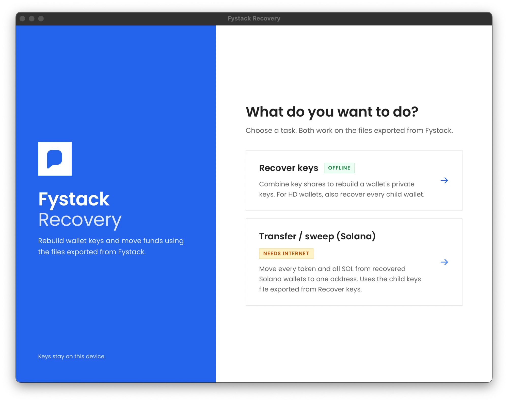

# Fystack Recovery

Offline desktop app to reconstruct an MPC wallet's private keys from threshold shares.
Built with [Wails](https://wails.io) (Go backend + React/TS frontend).

> ⚠️ Reconstructing a key materializes the full private key and defeats the wallet's
> threshold security. Run only offline, on an air-gapped machine, for recovery or migration.



## Supported share formats

| Format | Extension | Unlock with | Source |
|---|---|---|---|
| RSA export bundle | `.enc` | RSA private key (PEM) | Fystack web "Export Share", or `cosigner export-share` on a self-hosted server cosigner |
| Passphrase share | `.mshare` | 6-word passphrase | `cosigner-mobile` recovery export |

Both decrypt to tss-lib share data, then Lagrange interpolation reconstructs the
ECDSA and EdDSA keys, each verified against the wallet's public key.

## Flow

1. **Add & unlock shares** — add each participant's file, unlock with its RSA key or passphrase. Needs ≥2 shares per protocol.
2. **Recover** — confirm, then combine the shares.
3. **Result** — reveal / copy (clipboard auto-clears) / export the ECDSA + EdDSA keys.

## CLI

The same recovery engine (`internal/recovery`) is also exposed as a headless CLI,
so GUI and CLI never diverge.

```bash
go build -o build/bin/recover-cli ./cmd/recover-cli

recover-cli [--json] \
  --share wallet.enc    --rsa-key recipient_priv.pem \
  --share cos11.mshare  --passphrase "six-word-phrase"
```

Each `--share` is followed by its secret: `--rsa-key` for `.enc` bundles,
`--passphrase` for `.mshare` files. Prints ECDSA/EdDSA private keys, derived
addresses, and verification status. Needs at least 2 shares per protocol.

### HD-MPC wallets (child wallets)

Exporting an HD master from the UI gives two files: the share (`share-*.enc`) and the
derivation paths (`hd-paths-*.enc`: chain code, master pubkeys, every child path).

```bash
recover-cli --share share-master.enc --rsa-key priv.pem --share cos.mshare --passphrase "..." \
  --hd-bundle hd-paths-master.enc --children-out children.csv

# EdDSA (Solana) children can sign directly; batch = [{"wallet_id": "...", "message_hex": "..."}]
recover-cli ... --hd-bundle hd-paths-master.enc --sign-eddsa batch.json --sign-out sigs.json
```

**In the desktop app:** on step 1 click "+ Add child wallet list" (the `hd-paths-*.enc` file), then
"Select RSA private key…" to unlock it, like a share. After recovering, the result screen's
"Export all child keys…" writes the master and every child key to one file (`.json` for
`recover-cli`, `.csv` to import elsewhere).

To sign for many EdDSA wallets later, no shares are needed, only the exported JSON:

```bash
recover-cli --children-in child-keys.json --sign-eddsa batch.json --sign-out sigs.json
```

To import EVM keys into MetaMask and other wallets, export password-protected keystore (v3) files,
one per wallet. In the app use "Export keystore files…" on the result screen; in the CLI:

```bash
echo "a strong password" > pw.txt
recover-cli --children-in child-keys.json --keystore-dir keystores --keystore-password-file pw.txt
```

Delete `pw.txt` afterwards. Solana keys cannot be exported this way (see below).

ECDSA child keys are plain secp256k1 keys (importable anywhere). EdDSA child keys are group
scalars, not ed25519 seeds, so external wallets can't import them — use `--sign-eddsa` instead.

### Solana sweep

In the desktop app, pick "Transfer / sweep (Solana)" on the home screen: load the child keys `.json`,
enter the destination, scan, review, then "Sign & send" (you must retype the destination) or
"Sign & save to file…" to broadcast later with `--sol-broadcast`. The same steps are available in the CLI:

Moves every SPL token, then all SOL, from each Solana wallet in the exported child keys to one address.
Wallets are found on-chain (`getTokenAccountsByOwner` for Token and Token-2022), so no token list is needed.
Empty token accounts are closed to reclaim rent. Dry run is the default; nothing is sent without `--send`.

```bash
# One machine that has the keys and network access
recover-cli --children-in child-keys.json --sol-sweep <destination>            # dry run
recover-cli --children-in child-keys.json --sol-sweep <destination> --send

# Air-gapped: keys never touch the online machine
recover-cli --children-in child-keys.json --sol-plan <destination> --plan-out plan.json   # online, keys not needed
recover-cli --children-in child-keys.json --sol-sign-plan plan.json --signed-out signed.json   # offline
recover-cli --sol-broadcast signed.json --send                                     # online
```

For the online planning step you can pass `--sol-addresses addresses.json` (an array of addresses or
`{wallet_id, address}`) instead of the keys file. The signing step re-checks that every transaction
only pays the destination, so a tampered plan file is rejected. The blockhash expires about 60-90 seconds
after planning, so plan and broadcast close together. Use `--rpc` for your own endpoint.

Not covered: compressed NFTs, stake accounts, DeFi positions, priority fees, and Token-2022 mints with
transfer hooks. Wallets without enough SOL for fees are skipped with a note.

## Develop

```bash
wails dev      # hot-reload dev
wails build    # produce build/bin/recovery.app
go test ./internal/recovery/   # backend recovery tests
```

## Build & distribute

Recovery users usually don't have a Go/Node toolchain, so ship a prebuilt binary.

**macOS** (build on macOS + Xcode):
```bash
wails build -platform darwin/universal   # Intel + Apple Silicon .app
```
Unsigned `.app` triggers Gatekeeper. Either sign + notarize with an Apple
Developer ID, or tell users to right-click → Open once.

**Windows**:
```bash
wails build -platform windows/amd64 -nsis   # .exe installer
```
Sign with a code-signing cert to avoid SmartScreen. macOS/Linux can
cross-compile the Windows build; a macOS `.app` must be built on macOS.

**Air-gapped handoff** (this is a key-recovery tool):
- Build on a clean machine, then publish a checksum with the binary:
  ```bash
  shasum -a 256 build/bin/recovery.app/Contents/MacOS/recovery
  ```
- Have users verify the checksum and disconnect from the network before opening.

Requires Go, Node, and the [Wails CLI](https://wails.io/docs/gettingstarted/installation).
`tss-lib` and `agl/ed25519` use
`replace` in `go.mod` to point at the Fystack forks.
